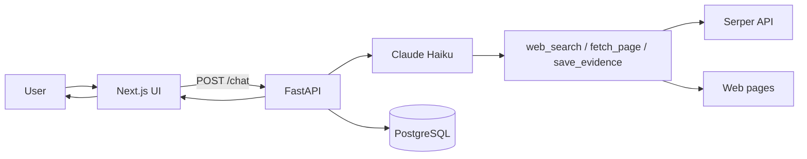
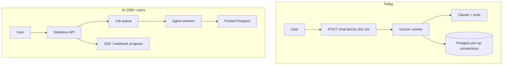

# Research Agent

Ask a research question, get a sourced brief back.

This is a small web app for topics that need more than a quick answer. You type a question—markets, tech comparisons, "what's the state of X in 2026"—and the agent searches the web, reads sources, saves the important claims, and writes a structured report. You can follow up in the same session or pick up an older one from the sidebar.

It's meant for evidence-backed analysis, not casual chat. Responses include sections like Summary, Key Findings, where sources disagree, a confidence note, and a source list. Saved evidence shows up in a side panel so you can see what the brief was built on.

## How it works

When you send a message, the Next.js frontend calls the FastAPI backend (`POST /chat`). The backend runs Claude (Haiku) in a tool loop—up to 12 calls per request:

1. **web_search** — queries Google via Serper and returns a handful of results
2. **fetch_page** — pulls readable text from a URL
3. **save_evidence** — stores a claim, quote, and source URL in Postgres for that session

The model is prompted to research a few angles, save the strongest evidence, then stop searching and write the brief. If it hits the tool limit, it synthesizes from what it already gathered. Messages, sessions, and evidence all live in PostgreSQL.



**Stack:**

| Piece | Role |
|-------|------|
| `frontend/` | Next.js UI, optional Stack Auth |
| `Backend/` | FastAPI agent API |
| Postgres | Session history and saved evidence |
| Anthropic | LLM (required) |
| Serper | Web search (required) |

For HTTP details and request/response shapes, see [frontend/docs/API.md](frontend/docs/API.md).

## Design decisions

These choices trade simplicity and debuggability for scale. They are intentional for a focused research MVP.

| Decision | Rationale |
|----------|-----------|
| Structured brief over open chat | Fixed sections in [Backend/prompt.py](Backend/prompt.py) force evidence-backed output, not conversational filler |
| Tool loop with hard budget (12 calls) | [Backend/session.py](Backend/session.py) caps cost and latency; budget reminders are injected in [Backend/main.py](Backend/main.py) when four or fewer calls remain |
| Evidence saved separately in Postgres | [save_evidence](Backend/tools.py) decouples claims from prose; the UI evidence panel shows what the brief was built on |
| Claude Haiku | [session.py](Backend/session.py) uses `claude-haiku-4-5` — fast and cheap enough for iterative research; quality is guarded by the prompt and post-checks |
| Sync `POST /chat` | Simplest end-to-end path for the MVP; the frontend shows rotating status copy while waiting ([frontend/components/chat/research-status.tsx](frontend/components/chat/research-status.tsx)) |
| Stack Auth + JWT | Multi-user sessions scoped by `user_id` in [Backend/session.py](Backend/session.py); `SKIP_AUTH` for local dev only |
| Postgres, not a vector DB | Evidence is session-scoped rows plus in-prompt context; cross-session RAG is not needed for v1 |

**Trade-off:** synchronous chat is easier to ship and reason about, but it is the main scalability bottleneck at high traffic. See [Production at scale](#production-at-scale).

## Production at scale

Today the agent runs inside the HTTP request. At 100k+ users that model breaks before the product logic does.



### What breaks first at 100k+ users

1. **Worker exhaustion** — [POST /chat](Backend/main.py) runs the full agent loop synchronously (roughly 30s–2m). One slow request ties up a Uvicorn worker; there is no queue and no horizontal agent pool.
2. **Database connection pressure** — [Backend/db.py](Backend/db.py) opens a new `psycopg2` connection per operation; no pool and no read replicas.
3. **Unbounded cost and abuse** — No per-user rate limits, quotas, or Serper/Anthropic budget enforcement; a single user can trigger many tool calls and LLM rounds per message.
4. **SSRF via `fetch_page`** — [Backend/tools.py](Backend/tools.py) fetches arbitrary URLs with no allowlist or IP blocking.
5. **Context and cost growth on follow-ups** — Full message history is replayed each turn; long sessions get slower and pricier with no summarization or windowing.
6. **Single Postgres, no HA** — Docker volume only in the default setup; no backups, replicas, or migration tooling (schema via `CREATE TABLE IF NOT EXISTS` on import).
7. **Wide CORS** — `allow_origins=["*"]` in [Backend/main.py](Backend/main.py).

### What to monitor

| Signal | Why |
|--------|-----|
| `POST /chat` p95/p99 latency | Detect worker saturation before users churn |
| Tool calls per request + truncation rate | [ChatResponse.truncated](Backend/models.py) — budget pressure indicator |
| Tokens per session / per user | Direct Anthropic cost driver |
| Brief retry rate | [is_brief_complete](Backend/main.py) failures — quality regression |
| Serper + Anthropic error rates | External dependency health |
| DB connection count + query latency | Pool exhaustion early warning |
| Evidence count distribution | Too low = thin research; too high = budget misuse |

### What to fix first

1. **Async job model** — enqueue research runs, return a job ID, stream progress via SSE; shorten HTTP lifetime.
2. **DB connection pooling + migrations** — PgBouncer or an application pool; Alembic (or similar) for schema changes.
3. **Rate limits + per-user quotas** — cap concurrent runs and daily spend.
4. **Observability** — OpenTelemetry traces per tool call, structured logs with `session_id`, dashboards and alerting.
5. **SSRF hardening** — URL allowlist, block private IPs, timeouts, and response size caps on `fetch_page`.

## Quality and evaluation

A system with no eval is a system you cannot improve. Quality is defined in four dimensions, then measured where possible.

### Quality definition

1. **Structural completeness** — the brief has the required markdown sections.
2. **Evidence grounding** — claims trace to fetched URLs saved via `save_evidence`.
3. **Research depth** — enough sources without hitting the tool budget.
4. **Honesty** — contradictions and confidence sections reflect uncertainty.

### Implemented today (runtime guards)

These run on every request. They are not a substitute for an offline eval suite.

| Mechanism | Location | Limit |
|-----------|----------|-------|
| Section check + one retry | [is_brief_complete()](Backend/main.py) — checks `## Summary` and `## Key Findings` plus minimum length | Does not verify Contradictions, Confidence, or Sources |
| Max-token continuation | [main.py](Backend/main.py) when `stop_reason == "max_tokens"` | Recovery attempt, not scored |
| Tool budget + force synthesis | 12-call cap; synthesis mode when exhausted | `truncated: true` surfaced to the UI |
| Prompt rules | [prompt.py](Backend/prompt.py) — no uncited URLs, report conflicts | Prompt-only; not verified programmatically |
| Response telemetry | `tokens_used`, `tool_calls`, `evidence_count`, `truncated` in the API | Logged but not aggregated |

### Eval pipeline to build next

```
Golden question set (20–50 topics)
  → run agent in CI/staging
  → automated checks: section headers, evidence_count ≥ N, no truncated
  → LLM-as-judge: citation fidelity vs saved evidence rows
  → regression gate on prompt/model changes
```

The eval suite lives in [`eval/`](eval/): golden questions, metrics, pytest, and [`eval/RESULTS.md`](eval/RESULTS.md). Run unit tests with `python eval/runner.py --unit-only`; live runs via `./eval/run_docker.sh --quick`.

## What we chose not to build

Scope was limited to a coherent research agent, not a full platform.

| Not built | Why |
|-----------|-----|
| Real-time streaming (SSE) | Sync path ships faster; status copy simulates progress |
| Model selection | `ChatRequest.model` is reserved in the API but the backend uses fixed Haiku — avoids an eval matrix explosion in v1 |
| Vector DB / cross-session RAG | Session-scoped evidence is enough for research briefs |
| Multi-agent orchestration | A single tool loop is easier to debug and evaluate |
| Background workers / job queue | Deferred until scale demands it |
| Full observability stack | Health check and API response fields only |
| CI, tests, load tests | Focus on the agent loop and UX for assignment scope |
| Billing, admin, content moderation | Not core to the research MVP |
| localStorage session restore | URL routing (`/chat/[sessionId]`) and `GET /sessions` are the source of truth |

## Known limitations

What still needs work, stated plainly:

- Full golden eval (25 cases) not run on every commit (cost); use `./eval/run_docker.sh` manually.
- Brief completeness check is partial (two of five sections).
- No programmatic citation verification against saved evidence rows.
- `fetch_page` SSRF risk; no caching of search or page results.
- Follow-up sessions replay full history — no summarization.
- No automated tests (pytest/Jest) or GitHub Actions.
- Schema bootstrap only — no versioned migrations.
- Production auth requires Stack Auth setup; `SKIP_AUTH` must never ship to production.
- External API failures surface as tool errors only — no circuit breakers or HTTP-layer retries.

This repo is a coherent end-to-end research agent MVP. It is not a production platform at 100k+ users without the async, observability, and eval layers above.

## Run locally with Docker Compose

You need Docker and Docker Compose, plus API keys for Anthropic and Serper. If you want real sign-in instead of dev mode, you'll also need Stack Auth values (see environment variables below).

```bash
cp .env.example .env
```

Edit `.env` and set at least:

```bash
ANTHROPIC_API_KEY=your_key_here
SERPER_API_KEY=your_key_here
```

For the fastest local setup without login, set:

```bash
SKIP_AUTH=true
```

Then start everything:

```bash
docker compose up --build
```

First run will build images and wait for Postgres and the backend health checks. When it's up:

- **App:** http://localhost:3000
- **API:** http://localhost:8000
- **Health:** http://localhost:8000/health

Useful commands:

```bash
docker compose up -d --build   # run in the background
docker compose down            # stop containers
docker compose down -v         # stop and delete the Postgres volume (wipes session data)
```

**Note:** `SKIP_AUTH` and other `NEXT_PUBLIC_*` variables are baked into the frontend image at build time. If you change them, rebuild:

```bash
docker compose up --build
```

A plain `docker compose restart` is not enough for those.

## Environment variables

| Variable | Required | Notes |
|----------|----------|-------|
| `ANTHROPIC_API_KEY` | Yes | Claude API |
| `SERPER_API_KEY` | Yes | Web search |
| `SKIP_AUTH` | No | Set to `true` for local dev without Stack Auth |
| `NEXT_PUBLIC_API_URL` | No | Defaults to `http://localhost:8000` |
| `NEXT_PUBLIC_STACK_PROJECT_ID` | If auth on | Stack Auth |
| `NEXT_PUBLIC_STACK_PUBLISHABLE_CLIENT_KEY` | If auth on | Stack Auth |
| `STACK_SECRET_SERVER_KEY` | If auth on | Stack Auth |
| `JWKS_URL` | If auth on | JWT verification for the backend |
| `FRONTEND_PORT` | No | Default `3000` |
| `BACKEND_PORT` | No | Default `8000` |
| `POSTGRES_PORT` | No | Default `5432` |

Postgres credentials (`POSTGRES_USER`, `POSTGRES_PASSWORD`, `POSTGRES_DB`) default to `agent` / `agent` / `agent` and usually don't need changing for local runs.

## Deliverables

| Deliverable | Document / location |
|-------------|-------------------|
| Working agent (tools + session memory) | Run via [Docker](#run-locally-with-docker-compose); verify with [docs/DEMO.md](docs/DEMO.md) |
| Architecture decisions | [docs/ARCHITECTURE.md](docs/ARCHITECTURE.md) |
| Eval suite + baseline scores | [eval/](eval/) · [eval/RESULTS.md](eval/RESULTS.md) |
| Where it breaks + fix cost | [docs/LIMITATIONS.md](docs/LIMITATIONS.md) |

## Project layout

```
Agent/
├── Backend/          # FastAPI research agent
├── frontend/         # Next.js UI
├── eval/             # Golden set, metrics, runner, results
├── docs/             # ARCHITECTURE, LIMITATIONS, DEMO
├── docker-compose.yml
└── .env.example
```

## Without Docker

You can run the backend with `uvicorn` in `Backend/`, the UI with `pnpm dev` in `frontend/`, and point both at a local Postgres instance. Docker Compose is the straightforward path if you just want it running.
