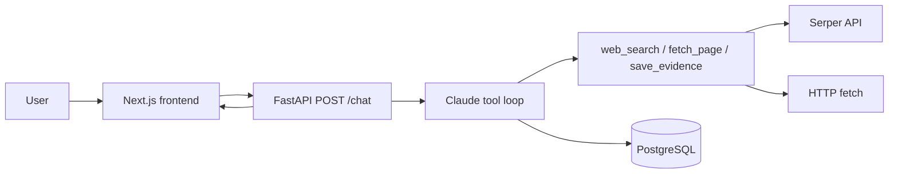

# Architecture Decision Record — Research Agent

This document explains why the Research Agent is built the way it is: framework choices, tools, data layer, and alternatives we rejected.

## Problem statement

Users need **evidence-backed research briefs** on complex topics—not open-ended chat. The system must search the web, read sources, persist claims per session, and produce a structured report with citations. Follow-up questions must reuse prior context within a session.

## High-level architecture

| Layer | Choice | Role |
|-------|--------|------|
| Frontend | Next.js App Router | Chat UI, session sidebar, evidence panel |
| API | FastAPI | Sync agent endpoint, JWT auth, session CRUD |
| Agent runtime | Anthropic Messages API + tool loop | Single-model research with hard tool budget |
| LLM | Claude Haiku (`claude-haiku-4-5`) | Cost/latency for iterative search |
| Search | Serper (Google results) | Structured JSON snippets + URLs |
| Fetch | `requests` + BeautifulSoup | Readable text extraction (4k char cap) |
| Memory | PostgreSQL | Message history + `session_evidence` rows |

## Why FastAPI + a hand-rolled tool loop (not LangGraph / CrewAI / AutoGen)

**Decision:** One Python service ([`Backend/main.py`](../Backend/main.py)) runs a `while True` loop: call Claude → if `tool_use`, execute tools → append results → repeat until `end_turn` or budget exhausted.

**Rationale:**

- **Debuggability** — Every tool call is logged; no hidden graph state. Easy to trace a bad brief to a specific `fetch_page` or `save_evidence`.
- **Eval simplicity** — Golden questions map 1:1 to `run_agent(session_id, topic, user_id)` without orchestration framework overhead.
- **Scope fit** — One agent role (researcher → brief). Multi-agent delegation adds coordination bugs without clear benefit for v1.
- **Latency control** — Hard cap of 12 tool calls ([`Backend/session.py`](../Backend/session.py)) with forced synthesis is explicit in code.

**Rejected alternatives:**

| Alternative | Why not (for v1) |
|-------------|------------------|
| **LangGraph** | Strong for branching state machines; our flow is linear (research → synthesize). Extra dependency and learning curve for a single loop. |
| **CrewAI / AutoGen** | Multi-agent overhead; harder to attribute failures. Assignment focus is one coherent agent. |
| **Vercel AI SDK tool loop in Next.js** | Would couple agent logic to the frontend build and expose API keys client-side unless proxied anyway. Backend-owned loop keeps secrets server-side. |

## Why Anthropic Messages API (not OpenAI Assistants / Responses-only)

**Decision:** Direct `anthropic` Python SDK with `tools` on `messages.create`.

**Rationale:** Native tool-use blocks, predictable `stop_reason`, and Haiku pricing for multi-step research. System prompt ([`Backend/prompt.py`](../Backend/prompt.py)) enforces section structure and citation rules.

**Rejected:** OpenAI Assistants (opaque thread state, vendor lock-in for session store), raw completion without tools (no structured search/fetch).

## Why these three tools

| Tool | Purpose | Why this implementation |
|------|---------|-------------------------|
| `web_search` | Discover URLs | Serper returns top organic results as JSON—simpler than custom Google CSE or scraping SERPs |
| `fetch_page` | Ground claims in page text | BeautifulSoup strip + 4k cap balances context size vs. content; errors return strings so the model can skip |
| `save_evidence` | Session memory for claims | Postgres rows decouple evidence from prose; UI evidence panel and eval grounding checks use the same store |

**Rejected:**

| Alternative | Why not |
|-------------|---------|
| **Tavily / Exa / Bing APIs** | Serper was sufficient for MVP; switching is an env-var + adapter change, not architectural |
| **Vector DB / RAG over past sessions** | Evidence is session-scoped; cross-session semantic search is out of scope |
| **Built-in Anthropic web search** | Less control over result shape, cost attribution per query, and eval fixtures |

## Why PostgreSQL (not Redis-only / vector DB)

**Decision:** `chat_sessions` for message history; `session_evidence` for claims; `users` for Stack Auth IDs.

**Rationale:** Durable multi-turn history, simple relational queries for sidebar and evidence API, no extra infrastructure for v1.

**Rejected:** Redis-only (weaker durability story for research artifacts), Pinecone/Weaviate (no cross-session retrieval requirement).

## Why sync `POST /chat` (not SSE / job queue)

**Decision:** HTTP request blocks until the brief is ready; frontend shows rotating status copy.

**Rationale:** Fastest path to end-to-end MVP; fewer moving parts than workers + webhooks.

**Trade-off:** Does not scale to 100k concurrent long runs; see [LIMITATIONS.md](LIMITATIONS.md) for async job migration.

## Why structured brief sections (not free-form chat)

**Decision:** Required markdown headers (Summary, Key Findings, Contradictions, Confidence, Sources) in the system prompt.

**Rationale:** Makes output gradable, comparable across eval runs, and aligned with “research product” not “chatbot.” Runtime check [`is_brief_complete`](../Backend/brief_quality.py) retries once if Summary/Key Findings are missing; eval uses stricter five-section checks ([`eval/metrics.py`](../eval/metrics.py)).

## Auth and multi-user scope

**Decision:** Stack Auth JWT on API routes; `user_id` on all session rows; `SKIP_AUTH=true` for local Docker.

**Rationale:** Sessions are per-user without building custom auth.

## Observability (intentionally minimal)

Response fields: `tool_calls`, `tokens_used`, `evidence_count`, `truncated`. No OpenTelemetry in v1—deferred until async workers exist.

## Related docs

- [API contract](../frontend/docs/API.md)
- [Eval methodology](../eval/README.md) and [results](../eval/RESULTS.md)
- [Limitations and remediation](LIMITATIONS.md)
- [Root README](../README.md) — run instructions and production scale notes
