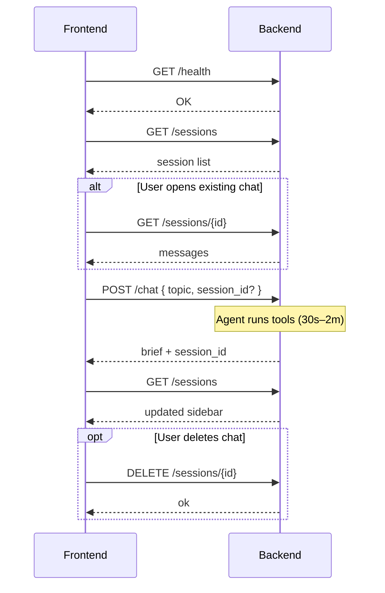

# Research Agent API — Frontend Integration Guide

This document describes the FastAPI backend used by the research agent UI. All authenticated routes require a **Bearer JWT** unless you run the backend with `SKIP_AUTH=true` (local development).

## Base URL

| Environment | URL |
|-------------|-----|
| Local | `http://localhost:8000` |
| Production | Set `NEXT_PUBLIC_API_URL` in the frontend `.env` |

Configure the frontend:

```bash
# frontend/.env.local
NEXT_PUBLIC_API_URL=http://localhost:8000
```

Use the typed client in `lib/api.ts` for consistent errors, auth headers, and TypeScript types.

---

## Authentication

Protected endpoints use `Authorization: Bearer <access_token>`.

| Mode | Backend env | Frontend behavior |
|------|-------------|-------------------|
| Production | `SKIP_AUTH=false`, `JWKS_URL` set | Send Stack Auth (or your IdP) access token on every request |
| Local dev / Docker | `SKIP_AUTH=true` and `NEXT_PUBLIC_SKIP_AUTH=true` (frontend build arg in Compose) | Omit the header; backend uses a fixed dev user; frontend skips Stack Auth |

**401 Unauthorized** — invalid or expired token. Refresh the session and retry once.

**404 Session not found** — session does not exist or belongs to another user. Clear local `session_id` and start a new chat.

---

## Endpoints

### `GET /health`

Public liveness check. No auth.

**Response `200`**

```json
{ "message": "OK" }
```

**UI use:** Show “API offline” banner if this fails on app load.

---

### `POST /chat`

Run the research agent for a topic. Creates a new session when `session_id` is omitted; continues an existing session when provided.

**Auth:** Required (unless `SKIP_AUTH`)

**Request body**

| Field | Type | Required | Description |
|-------|------|----------|-------------|
| `topic` | `string` | yes | User message / research question |
| `session_id` | `string \| null` | no | UUID from a prior response; omit for a new conversation |
| `model` | `string` | no | Default `claude-haiku-4-5` (reserved for future use) |

```json
{
  "topic": "Compare vector databases for RAG in 2026",
  "session_id": "a1b2c3d4-e5f6-7890-abcd-ef1234567890"
}
```

**Response `200`**

| Field | Type | Description |
|-------|------|-------------|
| `brief` | `string` | Final research brief (markdown) |
| `session_id` | `string` | Persist this in UI state / URL for follow-ups |
| `tool_calls` | `number` | How many tools the agent invoked |
| `tokens_used` | `number` | Approximate token usage for this turn |

```json
{
  "brief": "## Summary\n\n...",
  "session_id": "a1b2c3d4-e5f6-7890-abcd-ef1234567890",
  "tool_calls": 8,
  "tokens_used": 12450
}
```

**Errors**

| Status | When |
|--------|------|
| `401` | Missing/invalid token |
| `404` | `session_id` owned by another user |
| `500` | Missing `ANTHROPIC_API_KEY` or agent failure (`detail` string) |

**UI recommendations**

- Disable send while in flight; show streaming-style “Researching…” (request is synchronous and may take 30s–2m).
- Store `session_id` in React state + `localStorage` so refresh restores the thread.
- After success, append assistant `brief` to the message list; refetch `GET /sessions/{id}` if you need exact DB history.
- On `500`, show `detail` and offer retry with the same `session_id`.

---

### `GET /sessions`

List all chat sessions for the signed-in user, newest activity first.

**Auth:** Required

**Response `200`**

```json
{
  "sessions": [
    {
      "session_id": "a1b2c3d4-e5f6-7890-abcd-ef1234567890",
      "title": "Compare vector databases for RAG in 2026",
      "message_count": 4,
      "created_at": "2026-06-01T10:00:00Z",
      "updated_at": "2026-06-01T10:05:00Z"
    }
  ]
}
```

| Field | Description |
|-------|-------------|
| `title` | First user message, truncated to 80 chars; `null` if empty |
| `message_count` | Total rows (user + assistant) |
| `updated_at` | Last message timestamp — use for sidebar sorting |

**UI use:** Sidebar session list, empty state when `sessions.length === 0`.

---

### `GET /sessions/{session_id}`

Load full message history for one session.

**Auth:** Required

**Path:** `session_id` — UUID string

**Response `200`**

```json
{
  "session_id": "a1b2c3d4-e5f6-7890-abcd-ef1234567890",
  "messages": [
    {
      "role": "user",
      "content": "Compare vector databases for RAG in 2026",
      "created_at": "2026-06-01T10:00:00Z"
    },
    {
      "role": "assistant",
      "content": "## Summary\n\n...",
      "created_at": "2026-06-01T10:05:00Z"
    }
  ]
}
```

**Errors**

| Status | When |
|--------|------|
| `404` | Unknown session or not owned by user |

**UI use:** Hydrate chat view on load or when user picks a sidebar item. Render `role === "user"` vs `"assistant"` differently; assistant content is markdown.

---

### `DELETE /sessions/{session_id}`

Permanently delete all messages for a session.

**Auth:** Required

**Path:** `session_id` — UUID string

**Response `200`**

```json
{
  "ok": true,
  "session_id": "a1b2c3d4-e5f6-7890-abcd-ef1234567890",
  "deleted_messages": 4
}
```

**Errors**

| Status | When |
|--------|------|
| `404` | Session not found |

**UI use:** Confirm dialog → call delete → remove from sidebar → if active session was deleted, navigate to new chat and clear `localStorage` session id.

---

## Suggested UI state flow



---

## TypeScript types

These mirror the backend Pydantic models (see `lib/api-types.ts`).

```ts
export interface ChatRequest {
  topic: string;
  session_id?: string | null;
  model?: string;
}

export interface ChatResponse {
  brief: string;
  session_id: string;
  tool_calls: number;
  tokens_used: number;
}

export interface MessageItem {
  role: "user" | "assistant";
  content: string;
  created_at: string;
}

export interface SessionDetail {
  session_id: string;
  messages: MessageItem[];
}

export interface SessionSummary {
  session_id: string;
  title: string | null;
  message_count: number;
  created_at: string;
  updated_at: string;
}

export interface SessionList {
  sessions: SessionSummary[];
}

export interface DeleteSessionResponse {
  ok: boolean;
  session_id: string;
  deleted_messages: number;
}
```

---

## Example: using `lib/api.ts`

```ts
import {
  chat,
  deleteSession,
  getSession,
  listSessions,
  healthCheck,
  ApiError,
} from "@/lib/api";

async function runChat(topic: string, sessionId?: string, token?: string) {
  try {
    const result = await chat({ topic, session_id: sessionId }, token);
    return result;
  } catch (e) {
    if (e instanceof ApiError && e.status === 401) {
      // redirect to sign-in
    }
    throw e;
  }
}
```

---

## CORS

Backend allows all origins (`*`) with credentials. In production, point `NEXT_PUBLIC_API_URL` at your deployed API host.

---

## Agent behavior (for UX copy)

The agent researches topics using tools (web search, page fetch, evidence saving). A single `POST /chat` may take a long time while tools run (up to 12 tool calls). Set user expectations with loading copy such as “Searching sources…” rather than a generic spinner only.
